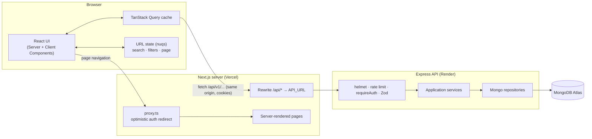
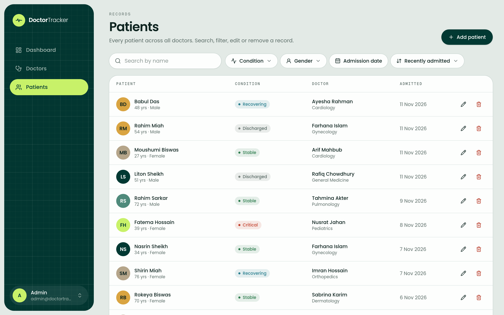
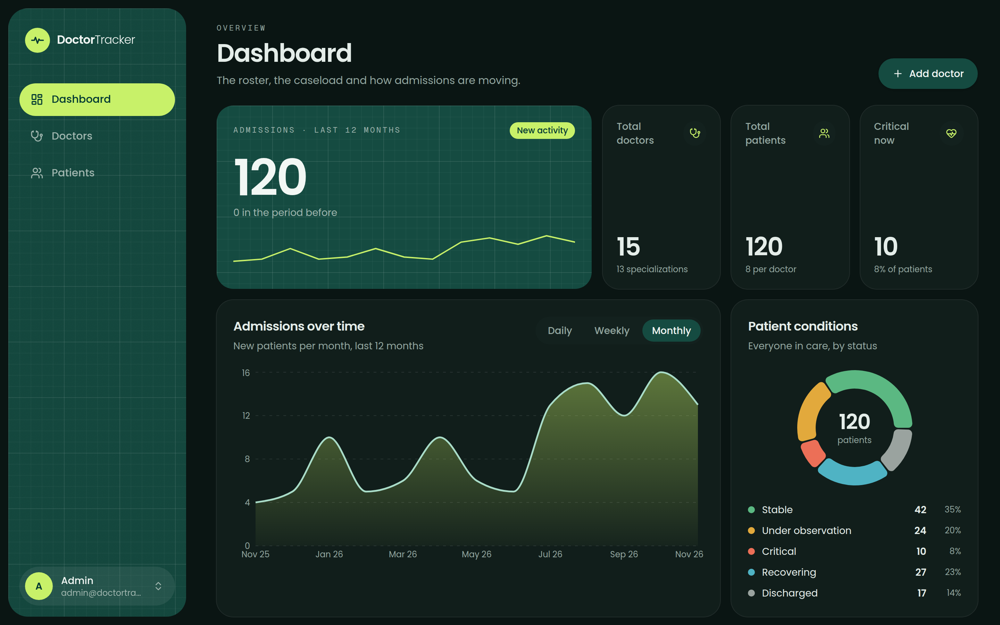
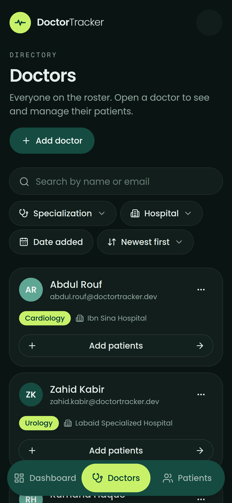
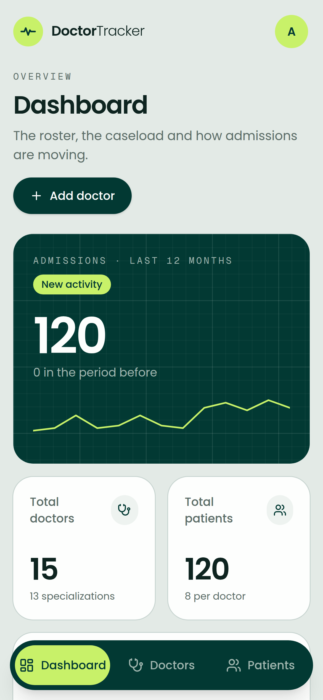
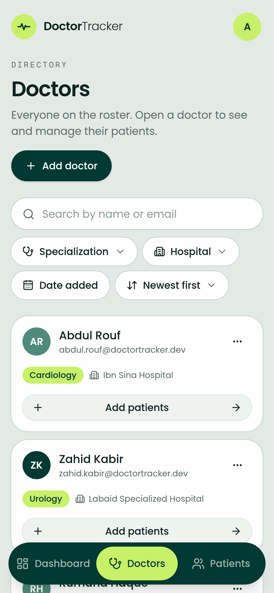

# Doctor Tracker · Web

Doctor Tracker is a secure admin portal for clinics and hospital groups. An administrator signs
in, keeps the roster of doctors up to date, records each doctor's patients, and sees at a glance
how the caseload is moving: how many doctors and patients there are, who is critical right now,
how admissions are trending, and which doctors and specialties carry the most patients. This
repository is the **Next.js frontend**. The REST API lives in a separate repository,
[doctor-tracker-api](https://github.com/SadeeMsr/doctor-tracker-api).

> **Live demo:** deployment is in progress; the URL and demo credentials are added here once
> the app is live.

## Contents

- [Features](#features)
- [Tech stack](#tech-stack)
- [Setup guide](#setup-guide)
- [System architecture](#system-architecture)
- [Technical decisions](#technical-decisions)
- [Visual evidence](#visual-evidence)
- [Project structure](#project-structure)
- [Scalability considerations](#scalability-considerations)

## Features

- **Authentication.** Email and password sign-in. Sessions use httpOnly cookies that the
  browser's JavaScript can't read, with silent token refresh. Every page except `/login` is
  protected.
- **Dashboard.** Total doctors, total patients, patients per doctor, and critical patients.
  Also admissions over time (daily, weekly or monthly), a patient-condition breakdown, the
  doctors with the most patients, and patients by specialization.
- **Doctors.** Create, edit and delete doctors. Search by name or email, filter by
  specialization, hospital and date added, sort, and paginate. Open a doctor to see, add and
  remove their patients.
- **Patients.** A dedicated page listing every patient. Search by name, filter by condition
  (more than one at a time), gender and admission date, sort, paginate, edit and delete.
- **Shareable state.** Search, filters, sort and page are all in the URL, so a filtered view can
  be bookmarked or shared, and the back button works.
- **Responsive.** Tables become stacked cards below 768px, and the sidebar becomes a bottom
  navigation bar on phones.
- **Every state is designed.** Skeletons that match the final layout while loading, empty states
  with a call to action, inline errors with Retry and a support reference, and toasts for
  mutations.
- **Light and dark themes.** Light, dark or follow the system, chosen in the account menu and
  remembered. Both themes come from one set of semantic design tokens.

## Tech stack

| Concern       | Choice                                                                                |
| ------------- | ------------------------------------------------------------------------------------- |
| Framework     | Next.js 16 (App Router, React Compiler, Cache Components, typed routes), React 19     |
| Language      | TypeScript 6, strict, with `noUncheckedIndexedAccess`                                 |
| Styling       | Tailwind CSS v4 with semantic design tokens, `tailwind-variants`                      |
| UI primitives | Base UI (`@base-ui/react`): accessible dialogs, selects, menus, popovers              |
| Server state  | TanStack Query 5                                                                      |
| URL state     | nuqs                                                                                  |
| Tables        | TanStack Table 9                                                                      |
| Forms         | React Hook Form + Zod 4 (schemas mirror the API's validation)                         |
| Charts        | Recharts 3                                                                            |
| Tooling       | ESLint 9 (with component size limits), Prettier, Husky, lint-staged, commitlint, pnpm |

## Setup guide

### Prerequisites

- Node.js **26** (see `.nvmrc`) and pnpm **12**. With Corepack, run `corepack enable`.
- The [API](https://github.com/SadeeMsr/doctor-tracker-api) running locally. Its README covers
  MongoDB and creating the admin account.

### Steps

1. Clone and install:

   ```bash
   git clone https://github.com/SadeeMsr/doctor-tracker-web.git
   ```

   ```bash
   cd doctor-tracker-web && pnpm install
   ```

2. Create your environment file from the example:

   ```bash
   cp .env.example .env.local
   ```

   | Variable                    | Required | Description                                                                                   |
   | --------------------------- | -------- | --------------------------------------------------------------------------------------------- |
   | `API_URL`                   | yes      | Base URL of the Express API. Next.js proxies `/api/*` to it. Default `http://localhost:4000`. |
   | `NEXT_PUBLIC_DEMO_EMAIL`    | no       | When set with the password, the login page shows a one-click "Use the demo account" button.   |
   | `NEXT_PUBLIC_DEMO_PASSWORD` | no       | The demo account's password. Leave both unset in a real deployment.                           |

3. Start the API (in the API repo, `pnpm dev`), then start the web app:

   ```bash
   pnpm dev
   ```

4. Open <http://localhost:3000> and sign in with the admin account you created with the API's
   `pnpm db:create-admin`.

### Scripts

| Command                        | What it does                                                                      |
| ------------------------------ | --------------------------------------------------------------------------------- |
| `pnpm dev`                     | Dev server with Turbopack on port 3000                                            |
| `pnpm build` / `pnpm start`    | Production build and server                                                       |
| `pnpm lint` · `pnpm typecheck` | ESLint (including the component size limits) and `tsc` with generated route types |
| `pnpm format`                  | Prettier                                                                          |

## Tests

```bash
pnpm test
```

68 tests with Vitest and Testing Library (jsdom). Each test sits **next to the file it covers**, inside its feature (`features/doctors/components/doctor-form.test.tsx`). Shared helpers live in `src/test/`: a provider wrapper and a fake API. Components are queried by role and accessible name, the way assistive technology finds them; writing these tests caught two real screen-reader labelling bugs.

| Area                | What's proven                                                                                                                                                                                                |
| ------------------- | ------------------------------------------------------------------------------------------------------------------------------------------------------------------------------------------------------------ |
| Doctor form         | client validation, the create request (body and `Idempotency-Key`), a duplicate-email `409` on the email field, "Save & add another" carrying the hospital, edit sending a PATCH with only the changed field |
| Patient form        | doctor picker hidden on a doctor's page, validation, ISO dates and a null email in the request, "Save & add another" keeping the doctor and admission date, server `422` errors on the right fields          |
| Doctors filters     | several specializations and hospitals written to the URL (names with commas intact), reset to page 1, "Clear all" with a count                                                                               |
| Login               | validation, redirect back to `?next=`, no open redirect, one generic error for bad credentials with the password cleared                                                                                     |
| Schemas and helpers | phone, email and date rules; request shaping; the specialization treemap's "Other" tile; time-zone-safe chart labels                                                                                         |
| API client          | refresh-and-retry on 401 (also `/auth/me`), no refresh for a failed login, redirect when the session is gone, typed errors, network failures, repeated query keys                                            |
| Keyboard shortcuts  | matching on Mac and other platforms, sequences, no firing while typing or with a dialog open, the WCAG 2.1.4 switch                                                                                          |

Husky runs the related tests on every commit and the full suite before every push; CI runs it too.

## System architecture



**How a request flows**

1. **Navigation.** `src/proxy.ts` runs before every page. If there's no `dt_refresh` cookie it
   redirects to `/login?next=…`. This is a UX shortcut only: the API checks the access token on
   every call.
2. **Data.** Components never call `fetch`. They use hooks from `features/<feature>/queries.ts`,
   which call typed functions in `features/<feature>/api.ts`. Those go through one client,
   `lib/api-client.ts`, which:
   - sends requests to the same-origin path `/api/v1/...`; Next.js rewrites them to the Express
     API, so cookies stay first-party;
   - parses the API's error envelope into a typed `ApiError` (network failures become
     `NETWORK_ERROR`);
   - on a `401`, refreshes the session once and retries. The refresh is shared across
     concurrent requests. If it fails, the user goes back to `/login`.
3. **State.** TanStack Query owns server data (caching, background refetch, `keepPreviousData`
   for pagination, optimistic deletes with rollback). Search, filters, sort and page live in
   the URL via nuqs. Everything else is local component state. There's no global store.
4. **Mutations** invalidate every query they affect (adding a patient refreshes that doctor,
   the patient lists and the dashboard). Creates send an `Idempotency-Key` header, so a retried
   submit can never create a duplicate patient.

**Error layers:** `api-client` → `ApiError` → TanStack Query (retries 5xx and network errors
only, never mutations) → the component (inline error with Retry, form field errors from the
API's `422`/`409` details) → the route `error.tsx` → `global-error.tsx`. Messages shown to users
come from one map in `lib/errors.ts`.

## Technical decisions

### 1. Same-origin `/api` proxy with httpOnly cookies, instead of tokens in JavaScript

**Problem.** The frontend (Vercel) and API (Render) run on different domains. The usual shortcut
is to return a JWT in the login response and keep it in `localStorage`. Then any XSS bug can
steal the session, and every request needs an `Authorization` header.

**Decision.** The browser only ever talks to the Next.js origin. `next.config.ts` rewrites
`/api/:path*` to the Express API, so the API's `Set-Cookie` headers land on the app's own domain:

- `dt_access`: a short-lived (15 min) JWT.
- `dt_refresh`: an opaque, rotating refresh token. The server stores only its SHA-256 hash.
- Both are `httpOnly`, `SameSite=Lax` and `Secure` in production. JavaScript never sees a token.

**Consequences.**

- No CORS preflights, and no third-party-cookie blocking (Safari ITP, Chrome's phase-out),
  because the browser sees a first-party request.
- `SameSite=Lax` plus JSON-only endpoints is the CSRF defence. An XSS bug can't read the
  session.
- `proxy.ts` can make the redirect decision on the server before any HTML is sent, so
  protected pages never flash for signed-out users.
- The API client handles expiry transparently: one shared refresh, one retry, then back to
  `/login`. Rotation with reuse detection on the API side means a stolen refresh token is
  revoked the first time both copies are used.
- Trade-off: every API call takes one extra hop through the Next.js server. For an admin tool
  that's negligible, and it's the price of cookies that are both secure and first-party.

### 2. TanStack Query + URL state (nuqs) instead of Redux or Zustand

**Problem.** Almost all of this app's state is a copy of server data: lists, details,
dashboard aggregates. The rest is "which page, which filters". A Redux or Zustand store would
mean hand-writing loading flags, cache invalidation, refetching and deduplication. And a
filtered view still couldn't be shared or survive a reload.

**Decision.** Split state by where it truly lives:

| State                                  | Owner                             | Why                                                                                                    |
| -------------------------------------- | --------------------------------- | ------------------------------------------------------------------------------------------------------ |
| Server data (doctors, patients, stats) | TanStack Query                    | Caching, deduplication, background refetch, retries, optimistic updates and invalidation come built in |
| Search, filters, sort, page            | The URL, via nuqs                 | Shareable, bookmarkable, back and forward work, and it survives a refresh. Typed parsers validate it   |
| Dialogs, form inputs                   | Local `useState`, React Hook Form | Short-lived and owned by one component                                                                 |

**Consequences.**

- Each feature has a query-key factory (`doctorKeys.list(filters)`). Since the filters come from
  the URL, the URL _is_ the cache key, and changing a filter fetches or reuses the right page
  automatically.
- Paginated lists use `placeholderData: keepPreviousData`, so the table never flashes empty
  between pages. Search input is debounced 300 ms before it reaches the URL, and changing a
  filter resets to page 1.
- Deletes are optimistic, with snapshot rollback. Mutations never auto-retry, because a
  retried POST could duplicate data; creates carry an `Idempotency-Key` instead.
- Fewer re-renders: components subscribe only to the query or URL key they read, and the React
  Compiler memoises automatically, so there's no hand-written `useMemo` or `useCallback`.
- Trade-off: there's no single global devtools timeline as with Redux. TanStack Query
  Devtools (dev only) covers server state, and the URL is self-describing.

### Also worth noting

- **Base UI + Tailwind + `tailwind-variants` instead of a pre-styled kit.** Base UI provides
  unstyled, accessible behaviour (focus traps, keyboard navigation, ARIA). The visual design is
  entirely our own tokens (`src/app/globals.css`), and variants are typed with `tv()`.
- **Enforced component boundaries.** ESLint caps files at 150 lines, functions at 80, and JSX
  depth at 5. Components are organised in four reuse tiers (primitives → shared composites →
  feature components → routes), and generic components never mention "doctor" or "patient".

## Visual evidence

### Desktop (1440 × 900)

| Sign in                                             | Dashboard                                                                 |
| --------------------------------------------------- | ------------------------------------------------------------------------- |
|  |  |

| Doctors                                                            | Doctor detail                                                              |
| ------------------------------------------------------------------ | -------------------------------------------------------------------------- |
|  |  |

| Patients                                                             |
| -------------------------------------------------------------------- |
|  |

### Dark theme

| Dashboard (desktop)                                                         | Doctors (mobile)                                                                                             |
| --------------------------------------------------------------------------- | ------------------------------------------------------------------------------------------------------------ |
|  |  |

### Mobile (390 × 844)

| Dashboard                                                                            | Doctors                                                                                        | Patients                                                                                         |
| ------------------------------------------------------------------------------------ | ---------------------------------------------------------------------------------------------- | ------------------------------------------------------------------------------------------------ |
|  |  |  |

## Project structure

```
src/
  app/                    routes only: thin pages, layouts, loading/error/not-found
    (auth)/login/         public sign-in page
    (dashboard)/          authenticated shell: dashboard, doctors, doctors/[id], patients
  features/<feature>/     auth · dashboard · doctors · patients
    api.ts                typed calls through lib/api-client
    queries.ts            TanStack Query hooks + query-key factory
    types.ts / schemas.ts response types and Zod form schemas mirroring the API
    components/ hooks/    feature UI and hooks
  components/
    ui/                   design-system primitives on Base UI (Button, Dialog, Select, …)
    data-table/ filters/  generic table, pagination and URL-bound filters
    charts/ feedback/     chart wrappers, stat cards, empty/error states, skeletons
    layout/               sidebar, header, mobile nav
  lib/                    api-client, query-client, errors, cn, constants
  proxy.ts                optimistic auth redirect (Next 16's middleware)
```

`AGENTS.md` holds the full set of conventions (layering, component limits, error handling,
idempotency, UX rules).

## Scalability considerations

- **The frontend scales horizontally.** It's stateless (auth is in cookies, data comes from
  the API), so Vercel can run as many instances as needed. Route segments stream with Suspense
  under Cache Components.
- **The network stays cheap as data grows.** Every list is paginated on the server (max 100 per
  page), search is debounced, previous pages stay cached, and the dashboard is one aggregate
  request rather than one per chart.
- **Data model growth.** Today a doctor has one specialization and one hospital, and a patient
  has one doctor, which matches the brief. For a real hospital group, the model would become
  FHIR-style:
  - `Doctor`
  - `Hospital`
  - `Affiliation` (doctor × hospital × department, like a FHIR PractitionerRole)
  - `Patient`
  - `Admission` (like a FHIR Encounter), with an embedded care team

  Recording the department on the admission keeps per-department statistics from
  double-counting patients who see several doctors. The feature-folder structure and the
  query-key factories let that change land one feature at a time.

- See the [API README](https://github.com/SadeeMsr/doctor-tracker-api#scalability-considerations)
  for the database and backend side.
